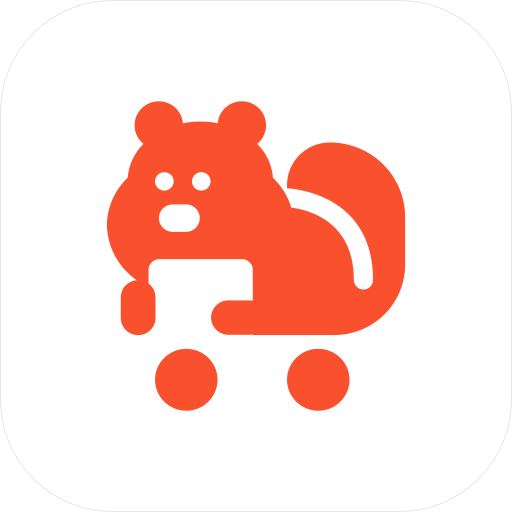
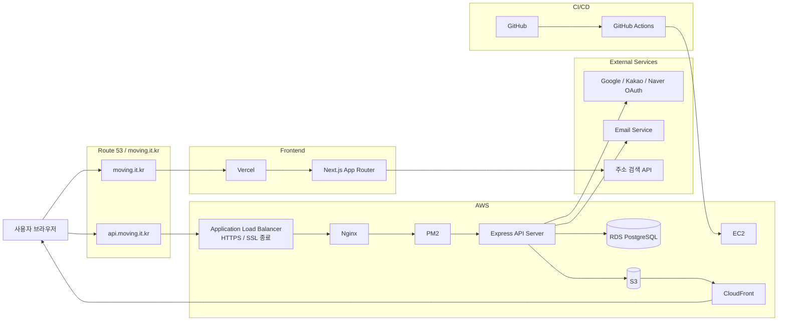

<p align="center">
  
</p>

<h1 align="center">무빙 (Moving)</h1>

<p align="center">
  이사 서비스를 요청하는 고객과 전문 기사님을 연결하는 견적 매칭 플랫폼
</p>

<p align="center">
  <a href="https://moving.it.kr"><strong>서비스 바로가기</strong></a>
  ·
  <a href="https://api.moving.it.kr/api-docs"><strong>Swagger API 문서</strong></a>
  ·
  <a href="https://github.com/kimchanhee0309/Moving-BE-Team1"><strong>Backend Repository</strong></a>
</p>

---

## 목차

1. [프로젝트 소개](#1-프로젝트-소개)
2. [기능 구현 영상](#2-기능-구현-영상)
3. [시스템 아키텍처](#3-시스템-아키텍처)
4. [기술 스택](#4-기술-스택)
5. [주요 라이브러리](#5-주요-라이브러리)
6. [팀 소개 및 문서](#6-팀-소개-및-문서)
7. [개인별 주요 작업 내역](#7-개인별-주요-작업-내역)
8. [프로젝트 구조](#8-프로젝트-구조)
9. [주요 기능 상세](#9-주요-기능-상세)
10. [성능 및 사용자 경험 개선](#10-성능-및-사용자-경험-개선)
11. [트러블 슈팅](#11-트러블-슈팅)
12. [프로젝트 실행 방법](#12-프로젝트-실행-방법)
13. [향후 개선 계획](#13-향후-개선-계획)

---

## 1. 프로젝트 소개

### 무빙이란?

무빙은 이사를 준비하는 고객과 전문 이사 기사님을 연결해 주는 양방향 견적 매칭 플랫폼입니다.

고객은 이사 종류, 출발지, 도착지, 이사 날짜를 등록하고 여러 기사님으로부터 견적을 받을 수 있습니다. 기사님은 본인이 제공할 수 있는 서비스와 지역에 해당하는 요청을 확인한 뒤 견적을 보내거나 요청을 반려할 수 있습니다.

### 개발 기간

- 2026.08 ~ 2026.10
- MVP 개발부터 AWS/Vercel 배포까지 진행

### 배포 주소

| 구분 | 주소 |
| --- | --- |
| Frontend | https://moving.it.kr |
| Backend API | https://api.moving.it.kr |
| Swagger UI | https://api.moving.it.kr/api-docs |
| FE Repository | https://github.com/kimchanhee0309/Moving-FE-Team1 |
| BE Repository | https://github.com/kimchanhee0309/Moving-BE-Team1 |

### 주요 사용자

- 일반 고객
  - 이사 견적 요청
  - 기사님 검색 및 지정 견적 요청
  - 받은 견적 비교 및 확정
  - 찜한 기사님 관리
  - 이사 완료 후 리뷰 작성

- 기사님
  - 서비스 가능 지역과 서비스 종류 설정
  - 받은 이사 요청 조회
  - 견적 발송 및 요청 반려
  - 확정된 견적과 반려 요청 관리
  - 마이페이지 및 리뷰 조회

---

## 2. 시스템 아키텍처



### 요청 흐름

1. 사용자는 `moving.it.kr`을 통해 Vercel에 배포된 Next.js 애플리케이션에 접근합니다.
2. API 요청은 `api.moving.it.kr` 도메인을 통해 AWS ALB로 전달됩니다.
3. ALB에서 HTTPS를 종료하고 EC2 내부의 Nginx로 HTTP 요청을 전달합니다.
4. Nginx는 PM2로 실행 중인 Express 서버에 요청을 전달합니다.
5. Express 서버는 Prisma를 통해 RDS PostgreSQL에 접근합니다.
6. 프로필 이미지는 S3에 저장하고 CloudFront를 통해 제공합니다.

---

## 4. 기술 스택

### Frontend

<p>
  
  
  
  
  
  
</p>

### Backend

<p>
  
  
  
  
  
  
</p>

### Deployment & Infrastructure

<p>
  
  
  
  
  
  
  
</p>

### Collaboration

<p>
  
  
  
  
</p>

---

## 5. 주요 라이브러리

### Frontend

| 라이브러리 | 사용 목적 |
| --- | --- |
| `@tanstack/react-query` | 서버 상태 관리, 캐싱, 재요청, 무한 스크롤 |
| `zod` | API 응답 및 입력 데이터 검증 |
| `next-intl` | Locale 기반 다국어 처리 |
| `motion` | UI 인터랙션과 애니메이션 |
| `pretendard` | 서비스 공통 웹 폰트 |
| `tailwindcss` | 디자인 시스템과 반응형 UI 구현 |

### Backend

| 라이브러리 | 사용 목적 |
| --- | --- |
| `express` | REST API 서버 구현 |
| `@prisma/client` | PostgreSQL ORM |
| `bcrypt` | 비밀번호 해시 및 검증 |
| `jsonwebtoken` | Access Token과 Refresh Token 발급 및 검증 |
| `cookie-parser` | HttpOnly 인증 쿠키 처리 |
| `cors` | 허용된 프론트엔드 Origin 관리 |
| `zod` | 요청 Query, Params, Body 검증 |
| `swagger-ui-express` | Swagger API 문서 제공 |
| `jest`, `ts-jest` | 단위 테스트 및 서비스 테스트 |
| `multer`, `sharp` | 이미지 업로드와 이미지 처리 |
| `@aws-sdk/client-s3` | S3 파일 저장 |
| `@aws-sdk/client-cloudfront` | CloudFront 캐시 무효화 |
| `nodemailer` | 이메일 인증 및 안내 메일 발송 |
| `express-rate-limit` | 인증 및 주요 API 요청 제한 |

---

## 6. 팀 소개 및 문서

### 팀원 구성

| 이름 | 담당 기능 |
| --- | --- |
| 김찬희 | 팀장, 공통 초기 설정, 받은 요청, 기사님 견적 관리, AWS 배포 |
| 김지훈 | 인증, 랜딩 페이지, 고객·기사 프로필, 기사님 마이페이지 |
| 노진우 | 견적 요청, GNB, 알림 |
| 이영주 | 기사님 찾기, 기사님 상세 |
| 조민성 | 찜한 기사님, 리뷰 |
| 권태현 | 일반 고객 견적 관리 |

> 기존 인증 및 랜딩 담당자의 중도 탈퇴 이후 해당 기능은 김지훈이 이어서 담당했습니다.

### 프로젝트 문서

| 문서 | 링크 |
| --- | --- |
| 팀 Notion | [바로가기](https://app.notion.com/p/99e6ff7cc5d882cf92c801fd84248bc2?v=8c26ff7cc5d882f6926008b26023b345) |
| API 명세서 | [바로가기](https://app.notion.com/p/API-93a6ff7cc5d883d4b3fe0178fe05aaf4) |
| Task List | [바로가기](https://app.notion.com/p/Task-list-3ca6ff7cc5d880a09255c800254cd337) |
| Figma | [바로가기](https://www.figma.com/design/fgvdOrZSUPdiBm3OwVPmCm/-%EC%8A%A4%ED%94%84%EB%A6%B0%ED%84%B0-%EA%B3%B5%EC%9C%A0%EC%9A%A9--%EB%AC%B4%EB%B9%99_V2?node-id=1-82&m=dev) |
| Swagger UI | [바로가기](https://api.moving.it.kr/api-docs) |

---

## 7. 개인별 주요 작업 내역

<details>
<summary><strong>김찬희 — 팀장 / 받은 요청 / 기사님 견적 관리 / 배포</strong></summary>

### Frontend

- Next.js App Router 기반 프로젝트 초기 구조 설계
- 공통 폴더, Provider, API Client, 환경변수 구조 구성
- 디자인 토큰, Pretendard 폰트, 공통 UI 기반 구성
- 기사님 받은 요청 목록 구현
- 견적 보내기 및 요청 반려 모달 구현
- 기사님이 보낸 견적 목록 및 확정 견적 상세 구현
- 반려한 요청 목록 구현
- TanStack Query 기반 무한 스크롤 및 Mutation 연동
- 모바일, 태블릿, 데스크톱 반응형 UI 대응
- API 오류, 빈 상태, 초기 로딩 및 추가 페이지 로딩 상태 처리

### Backend

- Express 애플리케이션 초기 구조와 공통 에러 처리 구성
- Prisma Schema와 Seed 데이터 구성
- 받은 요청 조회 API 구현
- 견적 발송 및 요청 반려 API 구현
- 기사님 견적 목록, 상세, 반려 요청 조회 API 구현
- Zod 요청 검증과 Jest 테스트 적용
- Swagger 문서 구성
- AWS EC2, RDS, ALB, Route 53, S3, CloudFront 배포 구성
- Nginx 및 PM2 기반 운영 서버 구성

</details>

<details>
<summary><strong>김지훈 — 인증 / 랜딩 / 프로필 / 마이페이지</strong></summary>

### Frontend

- 일반 고객 및 기사님 회원가입·로그인 화면 구현
- OAuth 로그인 흐름 구현
- 랜딩 페이지 구현
- 고객 프로필 등록 및 수정 구현
- 기사님 프로필 등록 및 수정 구현
- 기사님 마이페이지 구현
- 프로필 이미지 업로드 연동

### Backend

- 이메일 회원가입 및 로그인 구현
- Access/Refresh JWT 발급 및 검증
- HttpOnly Cookie 기반 인증 처리
- `/auth/me`, `/auth/refresh`, `/auth/logout` 구현
- Google, Kakao, Naver OAuth 연동
- 이메일 인증 및 비밀번호 재설정 구현
- 고객·기사 프로필 API 구현

</details>

<details>
<summary><strong>노진우 — 견적 요청 / GNB / 알림</strong></summary>

### Frontend

- 이사 견적 요청 입력 화면 구현
- 주소, 서비스 종류, 이사 날짜 입력 흐름 구현
- 역할별 GNB 구성
- 알림 목록과 읽음 상태 UI 구현
- SSE 기반 실시간 알림 연동

### Backend

- 견적 요청 등록 API 구현
- 견적 요청 상태 관리
- 알림 생성 및 조회 API 구현
- SSE 알림 스트림 구현

</details>

<details>
<summary><strong>이영주 — 기사님 찾기 / 기사님 상세</strong></summary>

### Frontend

- 기사님 목록 조회 화면 구현
- 서비스 및 지역 필터 구현
- 기사님 정렬과 검색 기능 구현
- 기사님 상세 페이지 구현
- 지정 견적 요청 흐름 연결

### Backend

- 기사님 목록 및 상세 조회 API 구현
- 지역·서비스 조건 검색 구현
- 정렬 및 페이지네이션 구현
- 기사님 평점과 견적 관련 통계 제공

</details>

<details>
<summary><strong>조민성 — 찜한 기사님 / 리뷰</strong></summary>

### Frontend

- 찜한 기사님 목록 구현
- 기사님 찜 등록 및 해제 인터랙션 구현
- 작성 가능한 리뷰 목록 구현
- 리뷰 작성 및 작성 완료 목록 구현

### Backend

- 찜 목록 조회, 등록, 해제 API 구현
- 작성 가능한 리뷰 조회 API 구현
- 리뷰 등록 및 조회 API 구현
- 리뷰 중복 작성 방지 처리

</details>

<details>
<summary><strong>권태현 — 일반 고객 견적 관리</strong></summary>

### Frontend

- 대기 중인 견적 목록 구현
- 받은 견적 상세 페이지 구현
- 견적 확정 기능 구현
- 과거 견적 목록 및 상세 구현
- 견적 상태별 화면과 예외 상태 처리

### Backend

- 고객이 받은 견적 목록 조회 API 구현
- 견적 상세 조회 API 구현
- 견적 확정 API 구현
- 과거 견적 목록 및 상세 조회 API 구현

</details>

---

## 8. 프로젝트 구조

```text
moving-fe-team1/
├─ public/
│  ├─ fonts/                       # Pretendard 폰트
│  └─ icons/                       # 서비스 공통 아이콘
│
├─ src/
│  ├─ app/
│  │  └─ [locale]/                 # Locale 기반 App Router
│  │     ├─ (public)/              # 비로그인 접근 가능 페이지
│  │     ├─ (auth)/                # 로그인 및 회원가입
│  │     ├─ (customer)/            # 일반 고객 전용 페이지
│  │     └─ (mover)/               # 기사님 전용 페이지
│  │
│  ├─ common/
│  │  ├─ api/                      # 공통 API Client
│  │  ├─ auth/                     # 인증 관련 공통 코드
│  │  ├─ components/               # Button, Input, Modal 등 공통 UI
│  │  ├─ constants/                # Route, 환경변수, 상수
│  │  ├─ hooks/                    # 공통 Hook
│  │  ├─ notification/             # 공통 알림 처리
│  │  ├─ utils/                    # 공통 Utility
│  │  └─ validation/               # 공통 검증 Schema
│  │
│  ├─ features/
│  │  ├─ auth/
│  │  ├─ customer-profile/
│  │  ├─ customer-quote/
│  │  ├─ favorite/
│  │  ├─ landing/
│  │  ├─ move-request/
│  │  ├─ mover-mypage/
│  │  ├─ mover-profile/
│  │  ├─ mover-quote/
│  │  ├─ mover-requests/
│  │  ├─ mover-search/
│  │  ├─ notification/
│  │  └─ review/
│  │
│  ├─ i18n/                        # 다국어 설정
│  ├─ providers/                   # Query, Auth, Modal Provider
│  └─ styles/                      # Global CSS와 디자인 토큰
│
├─ next.config.ts
├─ package.json
└─ README.md
```

### 구조 설계 기준

- `app`: URL과 페이지 조합을 담당합니다.
- `features`: 기능별 API, 타입, Hook, UI를 관리합니다.
- `common`: 특정 도메인에 종속되지 않는 공통 코드를 관리합니다.
- `providers`: 애플리케이션 전체에서 사용하는 Context와 Provider를 관리합니다.
- 페이지 컴포넌트에 비즈니스 로직을 집중시키지 않고 feature 단위로 분리했습니다.

---

## 9. 주요 기능 상세

### 9.1 인증 및 인가

- 일반 고객과 기사님 역할을 구분한 회원가입
- 이메일 로그인 및 OAuth 로그인
- Access Token과 Refresh Token을 HttpOnly Cookie로 관리
- Access Token 만료 시 Refresh API를 통한 재발급
- 역할과 프로필 등록 상태에 따른 페이지 접근 제어
- 이메일 인증 및 비밀번호 재설정
- 요청 Origin 검사와 인증 API Rate Limit 적용

### 9.2 견적 요청

- 서비스 종류 선택
  - 소형 이사
  - 가정 이사
  - 사무실 이사
- 출발지와 도착지 설정
- 이사 날짜 설정
- 활성화된 견적 요청 중복 생성 방지
- 지정 기사님에 대한 지정 견적 요청 지원

### 9.3 기사님 찾기

- 기사님 목록 및 상세 정보 조회
- 지역과 서비스 종류에 따른 필터
- 평점, 경력, 확정 건수 등 기사님 정보 제공
- 기사님 찜 등록 및 해제
- 기사님에게 지정 견적 요청

### 9.4 일반 고객 견적 관리

- 대기 중인 견적 목록 조회
- 견적별 기사님, 가격, 코멘트 확인
- 견적 확정
- 완료 및 과거 견적 조회
- 확정 견적을 기반으로 리뷰 작성

### 9.5 기사님 받은 요청

- 기사님의 서비스 종류와 가능 지역에 해당하는 요청 조회
- 요청 등록일 및 이사 날짜 기준 정렬
- 견적 금액과 코멘트를 포함한 견적 발송
- 반려 사유를 포함한 요청 반려
- 중복 견적 및 중복 반려 방지
- 요청별 견적 가능 인원 제한 처리

### 9.6 기사님 견적 관리

- 보낸 견적 목록 조회
- 확정된 견적 상태 확인
- 견적 상세 조회
- 반려한 요청 목록 조회
- 이사 완료 상태에 따른 카드 오버레이 제공

### 9.7 찜 및 리뷰

- 찜한 기사님 목록 조회
- 찜 등록 및 해제
- 작성 가능한 리뷰와 작성한 리뷰 구분
- 평점과 리뷰 내용 등록
- 동일 견적에 대한 중복 리뷰 방지

### 9.8 실시간 알림

- SSE를 통한 실시간 알림 수신
- 새로운 견적, 견적 확정 등 주요 이벤트 알림
- 알림 읽음 처리
- 브라우저 재연결 상황 대응

### 9.9 프로필 이미지

- 이미지 형식과 크기 검증
- 이미지 최적화 처리
- S3 저장
- CloudFront를 통한 이미지 제공
- 이미지 교체 시 기존 객체 삭제 및 캐시 무효화

---

## 10. 성능 및 사용자 경험 개선

### TanStack Query 기반 서버 상태 관리

- 조회 데이터의 캐싱과 재사용
- Mutation 성공 후 필요한 Query만 무효화
- 무한 스크롤 페이지 데이터 관리
- 다음 페이지 요청 실패 시 기존에 조회된 목록 유지
- 중복 요청 방지와 로딩 상태 분리

### 초기 로딩과 추가 로딩 상태 분리

무한 스크롤에서 첫 요청 실패와 다음 페이지 요청 실패를 구분했습니다.

- 첫 페이지 실패: 전체 오류 화면 표시
- 추가 페이지 실패: 기존 카드 목록을 유지하고 재시도 UI 표시

이를 통해 추가 데이터를 불러오지 못했을 때 기존 데이터까지 사라지는 문제를 방지했습니다.

### 사용자 입력 중복 제출 방지

- API 요청 중 버튼 비활성화
- 요청 처리 중 Modal의 Escape 및 배경 클릭 닫기 방지
- Mutation 완료 후 관련 Query 무효화
- 서버에서도 중복 견적과 중복 반려 검증

### 이미지 전송 최적화

- 원본 이미지를 그대로 서버에서 반복 전송하지 않고 S3에 저장
- CloudFront CDN을 통해 프로필 이미지 제공
- 이미지 교체 시 기존 파일과 CDN 캐시 정리

### 역할별 코드 분리

- 일반 고객과 기사님 화면을 Route Group으로 분리
- 도메인별 feature 폴더 구성
- 페이지에서 API 구현 세부 사항을 분리
- 공통 UI와 비즈니스 UI를 구분하여 유지보수성 향상

---

## 11. 트러블 슈팅

### 11.1 배포 서버가 RDS 대신 localhost를 바라보던 문제

#### 문제 상황

배포 환경에서 회원가입이나 데이터 조회를 시도하면 Prisma `P1001` 오류가 발생했습니다.

```text
Can't reach database server at localhost:5432
```

#### 원인 분석

로컬에서는 SSH Tunnel을 사용하기 위해 `localhost:5433`을 데이터베이스 주소로 사용했지만, 해당 환경변수가 EC2 운영 환경에도 적용되어 있었습니다.

EC2 서버에서 `localhost`는 RDS가 아니라 EC2 자기 자신을 의미하므로 데이터베이스에 연결할 수 없었습니다.

#### 해결 과정

- 로컬과 배포 환경의 `DATABASE_URL`을 분리
- EC2 환경에서는 RDS Endpoint를 직접 사용
- EC2 보안 그룹에서 RDS 보안 그룹으로의 5432 포트 접근 허용
- 환경변수 수정 후 Prisma Client 생성, Migration 적용, PM2 재시작
- PM2가 최신 환경변수를 읽도록 `--update-env` 적용

#### 결과

배포 환경에서 Prisma가 RDS PostgreSQL에 정상적으로 연결되었고 회원가입, 로그인 및 데이터 조회 기능이 정상 동작했습니다.

#### 배운 점

동일한 환경변수 이름을 사용하더라도 로컬, CI, 운영 환경에서 값과 네트워크 경로가 완전히 다를 수 있으므로 환경별 설정을 명확히 분리해야 한다는 점을 배웠습니다.

---

### 11.2 로그인 이후 SSE 알림 요청에서 CORS 오류가 발생한 문제

#### 문제 상황

로그인은 정상적으로 처리되었지만 배포 환경에서 알림 스트림 요청이 차단되었습니다.

```text
Access to resource at
https://api.moving.it.kr/notifications/stream
from origin https://moving.it.kr
has been blocked by CORS policy
```

#### 원인 분석

Frontend와 API가 서로 다른 서브도메인을 사용하고 있었지만 SSE 요청에 필요한 CORS 응답 헤더와 인증 쿠키 전달 설정이 일치하지 않았습니다.

일반 Fetch 요청뿐 아니라 EventSource 연결에서도 쿠키와 CORS 정책을 함께 고려해야 했습니다.

#### 해결 과정

- 백엔드 CORS 허용 Origin에 `https://moving.it.kr` 명시
- `credentials: true` 설정
- Frontend SSE 연결에서 인증 정보를 포함하도록 구성
- ALB, Nginx, Express를 거치는 과정에서 SSE 응답이 버퍼링되지 않도록 설정 확인
- 운영 환경 Cookie 옵션과 HTTPS 환경을 일치시킴

#### 결과

배포 환경에서 로그인 상태를 유지한 채 실시간 알림 스트림에 정상 연결할 수 있게 되었습니다.

#### 배운 점

SSE는 일반적인 REST 요청보다 연결이 오래 유지되기 때문에 CORS, Cookie, Proxy Buffering을 함께 확인해야 한다는 점을 배웠습니다.

---

### 11.3 기사님 API를 구현했지만 모든 요청이 404로 반환된 문제

#### 문제 상황

기사님 견적 관련 Controller와 Router를 구현했지만 `/movers/me/quotes` 요청이 모두 404로 반환되었습니다.

#### 원인 분석

기능 Router 내부에는 API 경로가 선언되어 있었지만 최상위 `apiRouter`에 `moverQuoteRouter`가 Mount되지 않았습니다.

Express는 파일이 존재하는 것만으로 Route를 자동 등록하지 않기 때문에 실제 요청 경로가 생성되지 않았습니다.

#### 해결 과정

- `src/routes/index.ts`에서 기사님 견적 Router를 Import
- `/movers/me` 경로에 Router Mount
- Swagger 문서의 경로와 실제 Router Prefix 비교
- 통합 요청을 통해 Route 등록 여부 확인

#### 결과

기사님 견적 목록, 상세, 반려 요청 API가 정상적으로 호출되었습니다.

#### 배운 점

Express에서는 Controller와 Router 구현뿐 아니라 최상위 Router 연결까지 하나의 기능 구현 범위로 확인해야 한다는 점을 배웠습니다.

---

### 11.4 반려 견적의 nullable 가격 때문에 목록 전체가 실패한 문제

#### 문제 상황

반려된 견적이 포함된 목록을 조회하면 서버에서 500 오류가 발생했습니다.

#### 원인 분석

반려 견적은 실제 가격을 제시하지 않으므로 `price`가 `null`일 수 있었지만, DTO 변환 과정에서는 모든 견적 가격이 반드시 존재한다고 가정하고 있었습니다.

하나의 반려 데이터 때문에 전체 목록 변환이 실패했습니다.

#### 해결 과정

- 견적 상태별 데이터 특성 정의
- `REJECTED` 상태에서 가격이 nullable임을 Prisma Schema, DTO, FE 타입에 반영
- API 응답 검증 Schema도 nullable 상태와 일치하도록 수정
- Seed 데이터에 반려 견적 케이스 추가
- 상태별 목록과 상세 테스트 작성

#### 결과

제안, 확정, 반려 상태가 함께 존재해도 견적 목록과 상세 API가 정상 응답하게 되었습니다.

#### 배운 점

데이터베이스, Backend DTO, API 명세, Frontend Schema가 동일한 도메인 규칙을 공유해야 한다는 점을 배웠습니다.

---

### 11.5 요청 처리 중 Modal을 다시 열어 중복 요청할 수 있던 문제

#### 문제 상황

견적 발송 또는 반려 요청 중 Modal의 버튼은 비활성화되었지만 Escape 키나 배경 클릭으로 Modal을 닫을 수 있었습니다.

사용자가 Modal을 다시 열면 첫 Mutation이 끝나기 전에 동일 요청을 다시 보낼 가능성이 있었습니다.

#### 원인 분석

Modal 내부 버튼만 제출 상태를 알고 있었고 Modal Shell은 Mutation 상태를 전달받지 못했습니다.

#### 해결 과정

- Modal Content에서 요청 처리 상태 관리
- 처리 중 닫기 버튼, Escape, 배경 클릭을 통한 닫기 제한
- Mutation 성공 이후에만 Modal 닫기
- Backend에서도 중복 요청 검증
- 성공 후 관련 목록 Query 무효화

#### 결과

사용자 인터랙션과 서버 상태가 일치하게 되었고 중복 견적 및 중복 반려 가능성을 줄였습니다.

#### 배운 점

중복 제출 방지는 버튼 비활성화만으로 끝나지 않으며 Modal의 모든 종료 경로와 서버 검증을 함께 고려해야 한다는 점을 배웠습니다.

---

## 12. 프로젝트 실행 방법

### Frontend

#### 저장소 Clone

```bash
git clone https://github.com/kimchanhee0309/Moving-FE-Team1.git
cd Moving-FE-Team1
```

#### 패키지 설치

```bash
npm ci
```

#### 환경변수 설정

프로젝트 루트에 `.env.local` 파일을 생성합니다.

```env
NEXT_PUBLIC_API_URL=http://localhost:4000
NEXT_PUBLIC_JUSO_API_KEY=your-address-api-key
```

> 실제 환경변수 이름은 프로젝트의 `.env.example`과 `src/common/constants/env.ts`를 기준으로 확인해 주세요.

#### 개발 서버 실행

```bash
npm run dev
```

기본 주소:

```text
http://localhost:3000
```

#### 빌드 및 검사

```bash
npm run lint
npm run build
npm start
```

### Backend

Backend 실행 방법은 아래 저장소에서 확인할 수 있습니다.

- https://github.com/kimchanhee0309/Moving-BE-Team1

기본 개발 API 주소:

```text
http://localhost:4000
```

Swagger UI:

```text
http://localhost:4000/api-docs
```

---

## 13. 향후 개선 계획

- Redis Cache-Aside 패턴을 활용한 기사님 목록 및 공개 조회 API 캐싱
- Redis Pub/Sub을 활용한 다중 서버 환경의 SSE 알림 확장
- Playwright 또는 Cypress 기반 E2E 테스트 추가
- 테스트 커버리지 기준 설정 및 CI 검증
- 운영 로그 수집과 APM 적용
- 이미지 업로드 진행률과 재시도 UX 개선
- 알림 재연결 및 누락 이벤트 복구 전략 고도화
- 접근성 검사와 키보드 내비게이션 개선
- 무중단 배포 및 Auto Scaling 구성
- 부하 테스트를 통한 병목 구간 측정 및 최적화

---

## 프로젝트 회고

> 프로젝트 회고 링크 또는 내용을 여기에 추가해 주세요.

[프로젝트 회고 바로가기](RETROSPECTIVE_URL)
message.txt
28KB
